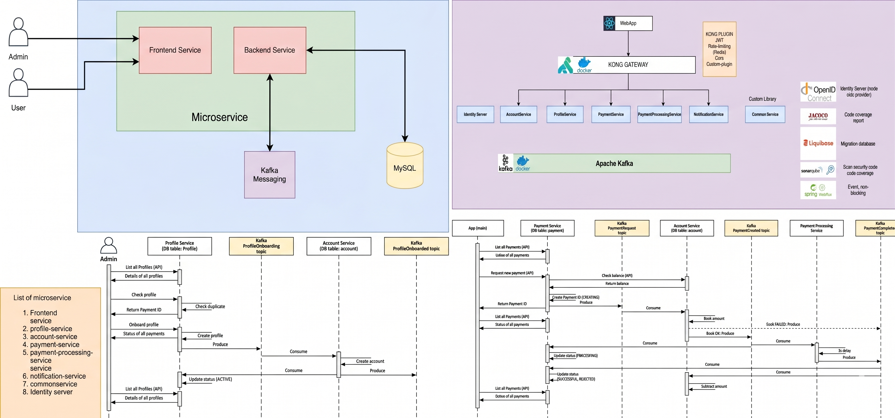
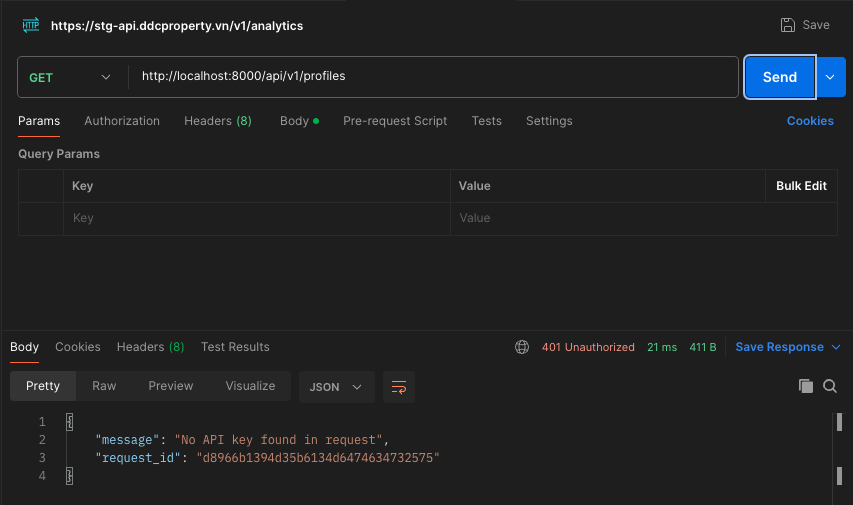
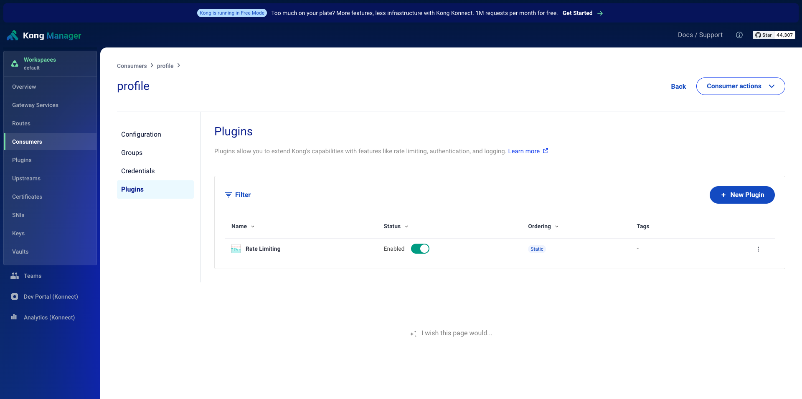
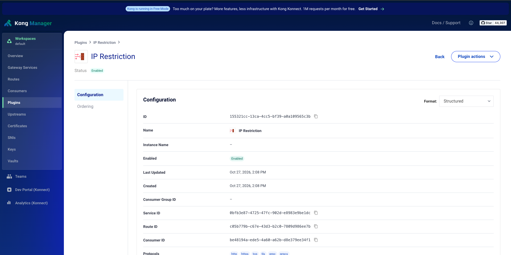
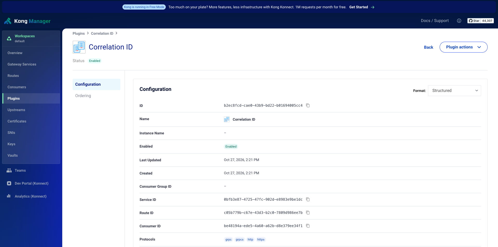
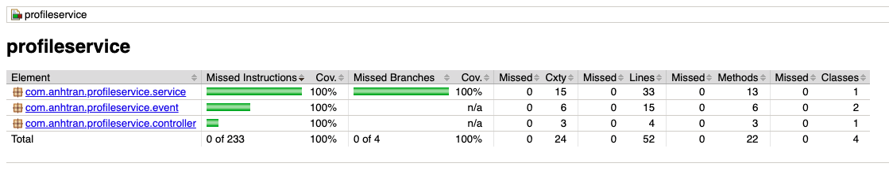
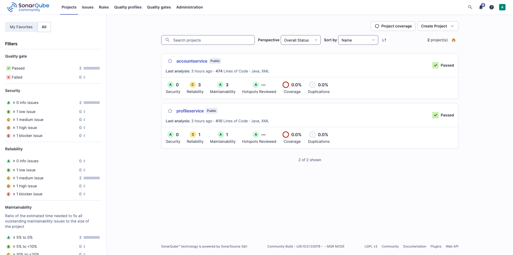

# Simple Bank

Dự án thực hành ngân hàng theo kiến trúc **microservice**, mô phỏng cách 1 ngân hàng mở hồ sơ khách hàng, tạo tài khoản và xử lý thanh toán bất đồng bộ qua **Kafka**. Mỗi service phụ trách một nghiệp vụ; dữ liệu được cập nhật qua sự kiện thay vì một giao dịch chung cho toàn hệ thống.

## Công nghệ và cách áp dụng

| Công nghệ | Áp dụng trong dự án / mục đích |
|---|---|
| **Java 17 · Spring Boot 3.0.1 · Maven Wrapper** | Nền tảng phát triển, quản lý dependency, build và test từng module. Spring Cloud BOM: `2022.0.0`. |
| **Spring WebFlux · Project Reactor** | Dùng `Mono`/`Flux` để kết hợp các bước bất đồng bộ; `WebClient` gọi Account Service để kiểm tra số dư. |
| **Spring Data R2DBC · MySQL** | Truy cập dữ liệu theo reactive API; tách database theo nghiệp vụ để service tự quản lý dữ liệu. |
| **Kafka · Reactor Kafka** | Producer/consumer trao đổi sự kiện onboarding và thanh toán, giảm phụ thuộc vào lời gọi HTTP xuyên suốt luồng. |
| **Liquibase** | Version hóa thay đổi cấu trúc/dữ liệu bằng XML changeset; chạy migration qua JDBC khi ứng dụng khởi động. |
| **Kong Gateway · PostgreSQL** | Demo định tuyến API, API key, giới hạn request, hạn chế IP và ghi log. PostgreSQL lưu cấu hình Kong ở chế độ có database. |
| **JUnit 5 · Mockito · Reactor Test** | Kiểm thử logic độc lập; `StepVerifier` kiểm tra dữ liệu/lỗi của `Mono` và `Flux`. |
| **JaCoCo · SonarQube** | Đo coverage; phân tích tĩnh để phát hiện lỗi tiềm ẩn, code smell, vấn đề bảo mật và code trùng lặp; đánh giá Quality Gate. |
| **Docker Compose · Confluent Control Center** | Chạy hạ tầng local và quan sát Kafka. Compose dùng Confluent `6.1.1`, ZooKeeper và PostgreSQL `16` cho SonarQube. |
| **Springdoc OpenAPI · Gson · Lombok · SLF4J** | Tài liệu API, chuyển sự kiện sang JSON, giảm mã lặp và ghi log ứng dụng. |

## Các service

| Module | Port | Trách nhiệm | Database |
|---|---:|---|---|
| `profileservice` | 9214 | Hồ sơ khách hàng, kiểm tra email trùng, trạng thái onboarding | MySQL `profiledb` |
| `accountservice` | 9211 | Tạo tài khoản, quản lý số dư và tiền đặt chỗ | MySQL `accountdb` |
| `paymentservice` | 9212 | Tiếp nhận yêu cầu và lưu trạng thái thanh toán | MySQL `paymentdb` |
| `paymentprocessingservice` | 9213 | Worker mô phỏng xử lý thanh toán từ Kafka | Không có database riêng |
| `commonservice` | — | Thư viện DTO, hằng số, exception và cấu hình dùng chung | — |

## Sơ đồ tổng quan và luồng nghiệp vụ



### Onboarding profile

Client tạo profile → Profile Service kiểm tra email trùng, lưu trạng thái `PENDING` → phát `profileOnboarding` qua Kafka → Account Service tạo tài khoản với số dư ban đầu và `reserved = 0` → phát `profileOnboarded` → Profile Service cập nhật `ACTIVE`. Trạng thái được đồng bộ sau qua sự kiện.

### Thanh toán

Payment Service gọi Account Service bằng `WebClient` để kiểm tra số dư. Nếu đủ, service lưu payment `CREATING` và phát `paymentRequest`. Account Service đặt chỗ tiền trong `reserved`, phát `paymentCreated`; Payment Processing Service mô phỏng kết quả rồi phát `paymentCompleted`. Khi thành công, Account Service trừ cả `balance` và `reserved`; khi thất bại, chỉ giải phóng `reserved`. Payment Service cập nhật trạng thái `PROCESSING`, sau đó `SUCCESSFUL` hoặc `REJECTED` theo sự kiện.

**Giới hạn demo:** `bookAmount()` hiện biến kết quả `false` thành `true` ở bước `flatMap` cuối; nhánh thiếu số dư khả dụng chưa được bảo đảm đúng. Worker chọn kết quả ngẫu nhiên và chờ 3 giây, chưa kết nối cổng thanh toán thật. Trước khi dùng thực tế cần sửa đặt chỗ và bổ sung cập nhật số dư nguyên tử, kiểu tiền phù hợp thay `double`, idempotency, outbox và retry/DLQ.

### Kong Gateway

Ở cấu hình demo, request tới `:8000/api/v1/profiles` đi qua Kong rồi đến Profile Service `:9214`. Key Auth có thể trả `401`, Rate Limiting trả `429`; IP Restriction kiểm soát địa chỉ truy cập. Correlation ID và File Log hỗ trợ đối chiếu request tại gateway. Kong Manager dùng cổng `8002`; cấu hình Kong lưu trong PostgreSQL riêng.

## Chạy local

Cần **JDK 17**, Docker và MySQL. Tạo các database `profiledb`, `accountdb`, `paymentdb`; cấu hình kết nối R2DBC/JDBC trong `src/main/resources/application.properties` của từng service. Liquibase dùng `db/changelog/changelog-master.xml` để áp dụng các changeset chưa chạy.

```sh
# Tại thư mục gốc: Kafka, ZooKeeper, Control Center, SonarQube và DB của SonarQube
docker compose up -d

# Cài thư viện chung vào Maven local
cd commonservice
./mvnw install -DskipTests

# Chạy từng service ở terminal riêng; thay profileservice bằng module tương ứng
cd ../profileservice
./mvnw spring-boot:run
```

Control Center: `http://localhost:9021`; SonarQube: `http://localhost:9000`.

## Test, coverage và review code

| Loại kiểm thử | Phạm vi hiện có |
|---|---|
| Unit test | Trong `profileservice`: service, controller, producer, consumer; dùng JUnit 5, Mockito và StepVerifier. |
| Integration test | `@SpringBootTest` + `WebTestClient` gọi HTTP trên port ngẫu nhiên; repository và Kafka producer/consumer được mock, Liquibase bị tắt trong lớp `IntegrationTest`. |
| Kiểm thử thủ công | Postman và Kong Manager kiểm tra route, API key, giới hạn request, IP và log. |

Chạy trong thư mục `profileservice`:

```sh
./mvnw clean verify
open target/site/jacoco/index.html   # macOS: mở báo cáo coverage
```

JaCoCo `0.8.8` đã được cấu hình ở module này, tạo HTML tại `target/site/jacoco/index.html` và XML tại `target/site/jacoco/jacoco.xml`. Kết quả test nằm trong `target/surefire-reports/`. Nếu test thất bại trước bước tạo report nhưng đã có `target/jacoco.exec`, chạy `./mvnw jacoco:report` để xem coverage; thao tác đó không làm test trở thành thành công.

Sau khi build/test thành công, đặt token SonarQube local trong biến môi trường `SONAR_TOKEN`, rồi chạy:

```sh
./mvnw sonar:sonar \
  -Dsonar.host.url=http://localhost:9000 \
  -Dsonar.coverage.jacoco.xmlReportPaths=target/site/jacoco/jacoco.xml
```

## Cấu hình Kong Gateway

Mở từng nhóm để xem.

<details>
<summary>Kong: định tuyến và bảo vệ API</summary>


Route `/api/v1/profiles` trỏ tới Profile Service.



Request thiếu API key bị Kong từ chối với HTTP 401.



Plugin Rate Limiting được bật cho consumer trong môi trường demo.



Plugin IP Restriction được bật để kiểm soát địa chỉ truy cập.

</details>

<details>
<summary>Kong: theo dõi request</summary>


File Log ghi request vào `/tmp/file.log` trong container Kong.



Plugin Correlation ID được bật để gắn mã định danh cho request.

</details>

<details>
<summary>JaCoCo và SonarQube</summary>



JaCoCo hiển thị 100% coverage trong phạm vi 4 lớp được đưa vào report; không đại diện toàn bộ dự án.



SonarQube hiển thị Quality Gate Passed cho hai project. Coverage trên ảnh vẫn là 0%, chưa phản ánh report JaCoCo ở ảnh trên.

</details>
